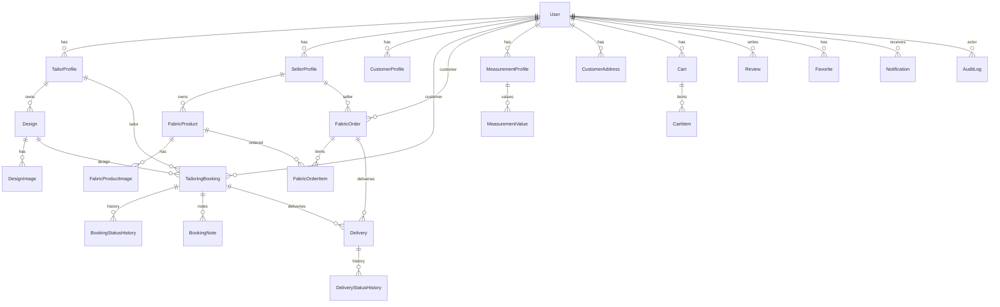

# The World of Tailors ERD

Constraints: unique email, unique business slugs, FKs, monetary precision (Float for SQLite, Decimal for Postgres prod), positive quantities, status history, inventory movement audit.
